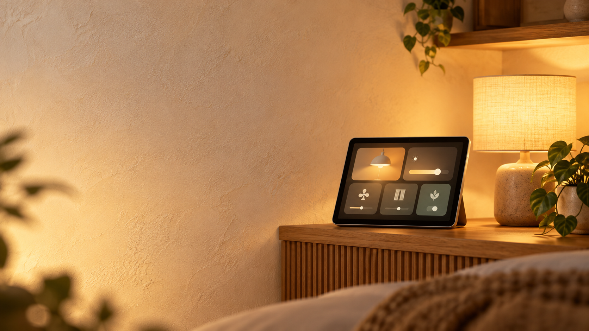

# Smart Home Wallpad



> 내 방의 조명, 커튼, 스마트 멀티탭, 카메라를 한 화면에서 제어하는 Android 월패드 앱

<p>
  
  
  
</p>

## 소개

`Smart Home Wallpad`는 태블릿의 가로 화면과 스마트폰의 세로 화면에 맞춰 구성되는 개인 방용 스마트홈 대시보드입니다.

현재는 실제 하드웨어 연동 전 단계로, 기기 응답을 모사하는 목업 저장소를 사용합니다. 이후 ESP32, MQTT 또는 Home Assistant 연동으로 확장할 수 있도록 UI와 기기 상태 처리를 분리했습니다.

## 주요 기능

| 영역 | 기능 |
| --- | --- |
| 방 조명 1·2 | 2구 스위치 방식의 개별 ON/OFF |
| 컴퓨터 조명 | ON/OFF 및 밝기 조절 |
| 보조등 | ON/OFF 및 밝기 조절 |
| 전체 조명 | 전체 켜기·끄기와 현재 상태 표시 |
| 커튼 | 열기·닫기·정지, 위치 슬라이더, 선택 상태 표시 |
| 스마트 멀티탭 | 1~3구별 연결 기기명 저장 및 개별 ON/OFF |
| 방 카메라 | 16:9 영상 연결 영역 및 전원 상태 |
| 실내 환경 | 온도·습도와 센서 연결 상태 표시 |

## UI 특징

- 웜 크림·골드 기반의 월패드 테마
- 큰 카드와 내부 제어 패널로 구분한 태블릿 친화적 레이아웃
- 세로 화면에서는 버튼이 잘리지 않도록 반응형 배치
- 밝기·커튼 위치는 탭과 드래그가 가능한 커스텀 원형 손잡이 슬라이더
- 조명 전체 상태에 따라 활성 버튼을 표시

## 기술 스택

- Kotlin
- Jetpack Compose + Material 3
- MVVM (`HomeViewModel`)
- Kotlin Flow / StateFlow
- Repository 패턴
- Minimum SDK 26

## 프로젝트 구조

```text
app/src/main/java/com/example/smart_home_wallpad/
├── data/
│   ├── model/          # 기기·센서·UI 상태 모델
│   └── repository/     # 목업 기기 상태 및 명령 처리
├── ui/
│   ├── components/     # 카드, 커스텀 슬라이더, 라인 아이콘
│   ├── theme/          # Material 3 테마
│   └── WallpadApp.kt   # 반응형 대시보드
├── viewmodel/          # 화면 상태 및 사용자 명령
└── MainActivity.kt
```

## 실행 방법

1. Android Studio에서 프로젝트를 엽니다.
2. Gradle Sync가 완료될 때까지 기다립니다.
3. 에뮬레이터 또는 Android 기기를 선택합니다.
4. 상단의 ▶ Run 버튼을 누릅니다.

### APK 만들기

Android Studio 메뉴에서 다음을 선택합니다.

```text
Build → Build Bundle(s) / APK(s) → Build APK(s)
```

생성된 디버그 APK는 보통 아래 경로에 있습니다.

```text
app/build/outputs/apk/debug/app-debug.apk
```

## 향후 계획

- [ ] ESP32 조명·커튼 실기기 연동
- [ ] MQTT 또는 Home Assistant 연동
- [ ] 카메라 스트림(RTSP/MJPEG/WebRTC) 연결
- [ ] 멀티탭 기기명 영구 저장
- [ ] 자동화 규칙과 장면 모드
- [ ] 조명 색온도 및 색상 제어

---

개인 방 환경에 맞춰 계속 확장 중인 스마트홈 월패드 프로젝트입니다.
