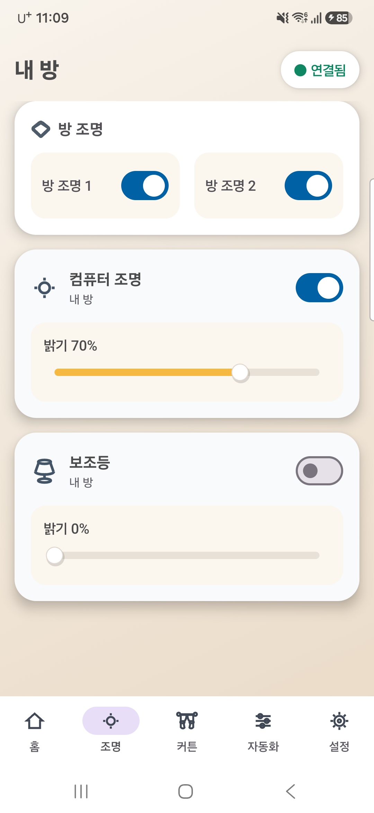

# Smart Home Project

스마트홈 월패드 앱과 ESP32 기반 장치를 함께 관리하는 통합 프로젝트입니다.

## Android 앱 화면

## 구성

| 폴더 | 설명 |
| --- | --- |
| `Android_App` | Kotlin 및 Jetpack Compose 기반 스마트홈 월패드 앱 |
| `Smart_Switch` | 서보 2개로 방 조명 스위치 2개를 제어하는 ESP32 프로젝트와 PC 중계 서버 |
| `Smart_temp` | ESP32 기반 스마트 온도계 프로젝트 |
| `개발문서` | 개발 진행 기록과 연동 문서 |

## 방 조명 연동

방 조명 1은 서보 1(GPIO 18), 방 조명 2는 서보 2(GPIO 19)에 연결됩니다. Android 앱은 PC 중계 서버를 통해 ESP32에 명령을 전달합니다.

세부 설정과 실행 순서는 [방 조명 연동 문서](개발문서/2026-10-22_방조명_ESP32_앱연동_작업기록.md)를 참고합니다.

## Git 관리 원칙

- Android 빌드 결과물, IDE 설정, `local.properties`는 커밋하지 않습니다.
- ESP32의 `sdkconfig`와 `sdkconfig.old`에는 장치별 Wi-Fi 설정이 포함될 수 있으므로 커밋하지 않습니다.
- Wi-Fi SSID, 비밀번호, 서버 IP 등 개인 환경 값은 소스 코드나 Git 저장소에 넣지 않습니다.
